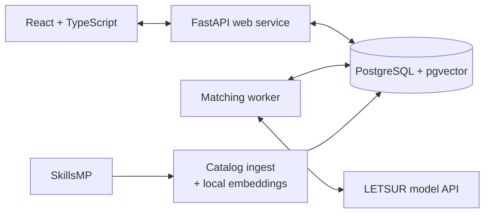

# Skinder

한국어 Readme: [README_KOREAN.md](README_KOREAN.md)

**Find agent skills for your task and your way of working.**

Access it here: https://web-production-49e9e.up.railway.app

Skinder helps developers discover skills: reusable instructions and workflows for coding agents such as Codex and Claude Code. Describe what you are working on, review recommendations with explanations, and save the skills you want to try.


*Catalog search in the live app. Personalized recommendations are available in Discover.*

## Why I built it

Finding the skills you want or need is often difficult and boring. Useful skills can be buried across the web, and finding them means knowing what to search for, opening repositories, and reading through instructions to judge whether they fit.

I built Skinder to make that discovery easier. The starting point is the task you want to accomplish. Working preferences add another dimension: a skill can address the right problem yet ask for more planning, explanation, or setup than you want.

## Using Skinder

1. **Describe your task.** Choose Codex or Claude Code. Optionally set preferences for planning, explanation length, verification, and the kind of output you want.
2. **Review the recommendations.** Each card explains task fit, working-style fit, and caveats. Open the original source for a closer look.
3. **Save or pass.** Use buttons, keyboard shortcuts, or swipe gestures. Optional pass reasons inform later recommendations; undo lets you revise a choice.

You can also search the catalog directly in **Explore** and revisit your collection in **Saved**. Browsing is public; matching, preferences, and saves require GitHub sign-in. Skinder helps you discover and review skills; installation and execution happen outside the app.

## How it works



The web service accepts a matching request and stores a job. A separate worker retrieves candidates, fetches available source excerpts, and asks the model for recommendations. It validates and stores the response, which the interface polls for. Catalog ingestion runs separately and resumes from saved checkpoints.

The stack is **React, TypeScript, and Vite** for the interface; **Python and FastAPI** for the backend; **PostgreSQL, pgvector, SQLAlchemy, and Alembic** for storage and migrations; and **local multilingual E5 embeddings** plus the **OpenAI SDK through LETSUR** for matching. Docker packages the web, worker, and ingest roles in one image.

## Key engineering decisions

### Retrieve locally before calling the model

Keyword search and semantic search produce a shortlist of at most 40 skills. Available `SKILL.md` excerpts give the model more context than listing descriptions alone. The full request has a size limit, and response validation rejects invented or duplicate skill IDs. If embeddings are unavailable, retrieval falls back to keyword search.

This bounds the model's input, but retrieval can miss useful skills before the model sees them. See [retrieval](src/skinder/retrieval.py), [source handling](src/skinder/sources.py), and [response validation](src/skinder/provider.py).

### Make paid work survive process failures

Matching runs in persisted jobs with request deduplication and expiring worker ownership. A worker can recover a job after a crash before dispatch. Once a model request may have been sent, an uncertain outcome fails the job without an automatic second call. This gives up some automatic recovery to avoid potentially paying twice.

The task, preferences, feedback, model, and prompt instructions are captured when the job is accepted; the exact provider request is stored before dispatch. See [job lifecycle](src/skinder/jobs.py), [worker](src/skinder/worker.py), and [process recovery tests](tests/test_process_recovery.py).

### Account for cost even when a request fails

Workers reserve budget transactionally before dispatch and reconcile it with provider-reported estimated cost. Concurrent workers share the same daily budget. If cost is unknown, the reservation remains for that UTC day, which can reduce available capacity even when a request did not complete.

Cancellation prevents a late result from replacing the user's recommendations, but cannot guarantee that the remote model stopped. A late response can still record its cost. See [budget and cancellation tests](tests/test_matching_lifecycle.py).

### Keep feedback tied to its meaning

Passing on a skill because it does not fit today's task should not become a permanent style preference. Cross-task context includes saves and explicit “wrong style” or “too much setup” feedback, scoped to the selected agent. The recommendation instructions give explicit preferences priority over inferred hints.

Feedback is stored context for future prompts. Undo also preserves bookmarks saved independently of a recommendation. See [feedback storage](src/skinder/user.py), [recommendation instructions](src/skinder/matcher.py), and [feedback tests](tests/test_user_store.py).

## Verification and current limits

The test suite covers concrete failure cases:

| Area | What is checked |
| --- | --- |
| [Worker recovery](tests/test_process_recovery.py) | Kill a worker before or after dispatch; verify recovery or prevention of a second provider call. |
| [Concurrency and cost](tests/test_matching_lifecycle.py) | Race budget reservations and cancellation; preserve earlier recommendations when another batch fails. |
| [Retrieval](tests/test_retrieval.py) | Check ranking mechanics, filtering, stale embeddings, interrupted indexing, and keyword fallback. |
| [Account boundaries](tests/test_api.py) | Reject attempts to access or change another account's sessions, jobs, and feedback. |
| [Frontend behavior](frontend/src/App.hosted.test.tsx) and [feedback](frontend/src/App.test.tsx) | Check sign-in states, asynchronous matching, feedback, and failed requests. |

Backend database tests use isolated schemas in real PostgreSQL. Model responses and test embeddings are controlled fixtures. [CI](.github/workflows/ci.yml) runs backend lint and tests, frontend tests, and the production frontend build. Commands are in the [development guide](docs/development.md#checks).

These checks establish application behavior, not recommendation quality. There is no labeled relevance benchmark yet; a next step is to compare keyword and hybrid retrieval on the same tasks and measure recommendation relevance, latency, and estimated cost.

Catalog coverage is limited to configured SkillsMP keyword searches. A listing does not establish agent compatibility, licensing, or revision; missing evidence stays unknown. Matching sends the task, preferences, relevant feedback, and shortlisted skill evidence to the configured model provider.

## Run locally

You need Docker with Compose, a GitHub OAuth app, and a LETSUR API key. Python and Node.js are included in the container build.

```sh
test -f .env || cp .env.example .env
```

Fill in `GITHUB_CLIENT_ID`, `GITHUB_CLIENT_SECRET`, `SESSION_SECRET` (a random value of at least 32 characters), and `LETSUR_API_KEY` in `.env`. Set the GitHub OAuth callback to `http://127.0.0.1:8742/api/auth/callback`.

```sh
docker compose up -d postgres
docker compose build
docker compose run --rm migrate
docker compose up -d web worker
docker compose --profile ops run --rm ingest
```

Open **http://127.0.0.1:8742**. The first build downloads the pinned embedding model. The ingest command populates the catalog and builds its search index; it runs within configured request budgets and can be repeated to resume unfinished searches.

For development outside containers, configuration, Railway deployment, and test commands, see the [development guide](docs/development.md).

## Explore the code

| Start here | Responsibility |
| --- | --- |
| [Discover view](frontend/src/views/DiscoverView.tsx) and [matching hook](frontend/src/hooks/useMatchSession.ts) | Recommendation cards, polling, save/pass, and undo. |
| [API](src/skinder/app.py) and [authentication](src/skinder/auth.py) | HTTP endpoints, GitHub sign-in, sessions, and account boundaries. |
| [Worker](src/skinder/worker.py) and [jobs](src/skinder/jobs.py) | Matching orchestration, recovery, cancellation, and budget accounting. |
| [Retrieval](src/skinder/retrieval.py) and [sources](src/skinder/sources.py) | Candidate selection and bounded source evidence. |
| [Catalog sync](src/skinder/sync.py) | SkillsMP imports, request budgets, and resumable checkpoints. |

## License

Skinder is licensed under the [MIT License](LICENSE). Third-party dependencies, fonts, models, and skill content remain subject to their respective licenses and terms.
