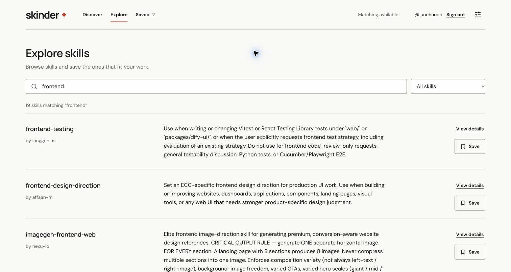
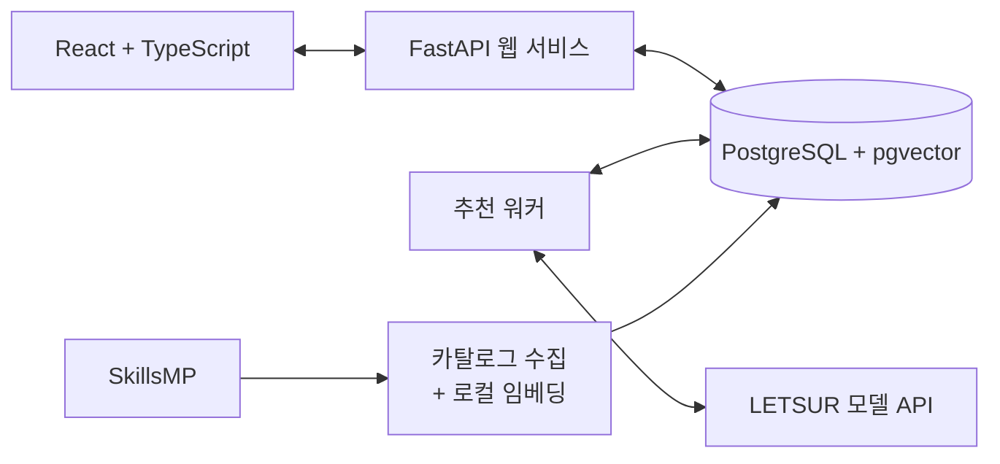

# Skinder

English Readme: [README.md](README.md)

**내 작업과 일하는 방식에 맞는 에이전트 스킬을 찾아보세요.**

서비스 이용: https://web-production-49e9e.up.railway.app

Skinder는 개발자가 자신에게 맞는 스킬을 찾도록 돕는 웹 앱입니다. 스킬은 Codex나 Claude Code 같은 코딩 에이전트가 활용하는 재사용 가능한 지침과 작업 절차입니다. 지금 하려는 일을 설명하면 추천 이유와 함께 스킬을 살펴보고, 사용해 보고 싶은 스킬을 저장할 수 있습니다.



*실제 서비스의 카탈로그 검색 화면입니다. 개인화된 추천은 Discover에서 이용할 수 있습니다.*

## 만든 이유

원하거나 필요한 스킬을 찾는 일은 어렵고 지루할 때가 많습니다. 유용한 스킬이 웹 곳곳에 묻혀 있어도, 무엇을 검색해야 할지 알아야 찾을 수 있습니다. 저장소를 하나씩 열고 지침을 읽으며 내 작업에 맞는지 판단하는 데도 시간이 듭니다.

Skinder는 이 탐색 과정을 더 쉽게 만들고 싶어서 시작했습니다. 출발점은 사용자가 지금 하려는 일입니다. 여기에 일하는 방식도 함께 고려합니다. 같은 문제를 해결하는 스킬이라도 계획을 얼마나 세우는지, 설명이 얼마나 긴지, 사전 설정이 얼마나 필요한지에 따라 잘 맞는 사람은 다를 수 있기 때문입니다.

## 사용 흐름

1. **할 일을 설명합니다.** Codex 또는 Claude Code를 선택합니다. 계획 수립 방식, 설명 길이, 검증 수준, 원하는 결과물에 대한 선호도도 설정할 수 있습니다.
2. **추천을 살펴봅니다.** 각 카드는 작업에 맞는 이유, 일하는 방식에 맞는 이유, 주의할 점을 보여줍니다. 원본 소스를 열어 자세히 확인할 수 있습니다.
3. **저장하거나 넘깁니다.** 버튼, 키보드 단축키, 스와이프를 사용할 수 있습니다. 넘기는 이유를 남기면 이후 추천에 참고하며, 실행 취소로 선택을 되돌릴 수 있습니다.

**Explore**에서는 카탈로그를 직접 검색하고, **Saved**에서는 저장한 스킬을 다시 볼 수 있습니다. 카탈로그는 로그인 없이 둘러볼 수 있으며, 추천·선호도 설정·저장에는 GitHub 로그인이 필요합니다. Skinder는 스킬 탐색과 검토를 돕고, 설치와 실행은 앱 밖에서 이루어집니다.

## 동작 구조



웹 서비스는 추천 요청을 받아 데이터베이스에 작업으로 저장합니다. 별도 워커가 후보 스킬을 검색하고, 가져올 수 있는 원본 내용을 읽은 뒤 모델에 추천을 요청합니다. 응답을 검증하고 저장하면 화면에서 주기적으로 조회해 결과를 표시합니다. 카탈로그 수집은 별도로 실행되며, 중단된 경우 저장된 진행 지점부터 이어집니다.

화면은 **React, TypeScript, Vite**, 백엔드는 **Python, FastAPI**로 구현했습니다. 저장과 스키마 변경에는 **PostgreSQL, pgvector, SQLAlchemy, Alembic**을 사용합니다. 추천에는 **로컬 다국어 E5 임베딩**과 **OpenAI SDK를 통한 LETSUR 호출**을 사용하며, 웹·워커·수집 프로세스를 하나의 Docker 이미지로 패키징합니다.

## 주요 설계 결정

### 모델 호출 전에 로컬에서 후보 좁히기

키워드 검색과 의미 기반 검색을 결합해 최대 40개의 후보를 고릅니다. 가져올 수 있는 `SKILL.md` 발췌문을 함께 전달해 모델이 목록의 짧은 설명 외에도 근거를 참고하게 합니다. 전체 요청 크기를 제한하고, 응답에 후보에 없는 스킬 ID나 중복 ID가 포함되면 거부합니다. 임베딩을 사용할 수 없을 때는 키워드 검색으로 동작합니다.

모델에 전달하는 입력을 제한할 수 있지만, 검색 단계에서 빠진 유용한 스킬은 추천할 수 없다는 한계가 있습니다. [검색 구현](src/skinder/retrieval.py), [원본 처리](src/skinder/sources.py), [응답 검증](src/skinder/provider.py)에서 확인할 수 있습니다.

### 프로세스가 중단되어도 유료 요청 상태 보존하기

추천 작업을 데이터베이스에 저장하고, 중복 요청을 구분하며, 워커의 작업 처리 권한에 만료 시간을 둡니다. 모델 요청을 보내기 전에 워커가 중단되면 다른 워커가 작업을 이어받을 수 있습니다. 이미 요청을 보냈을 가능성이 있다면, 결과를 알 수 없는 작업은 자동 재호출 없이 실패로 처리합니다. 중복 과금 가능성을 줄이기 위해 일부 상황에서는 자동 복구를 포기한 선택입니다.

작업을 접수할 때 사용자의 요청, 선호도, 피드백, 모델, 프롬프트 지침을 저장합니다. 모델에 실제로 보낼 요청 전체는 전송 전에 저장합니다. [작업 상태 관리](src/skinder/jobs.py), [워커](src/skinder/worker.py), [프로세스 복구 테스트](tests/test_process_recovery.py)에서 확인할 수 있습니다.

### 요청이 실패해도 비용 추적하기

워커는 모델 호출 전에 데이터베이스 트랜잭션으로 예산을 예약하고, 이후 제공자가 보고한 추정 비용을 반영합니다. 여러 워커가 같은 일일 예산을 공유합니다. 비용을 알 수 없으면 UTC 기준 해당 날짜의 예약분을 유지하므로, 요청이 완료되지 않았더라도 사용할 수 있는 예산이 줄어들 수 있습니다.

취소한 작업의 응답이 늦게 도착해도 사용자의 추천 결과를 덮어쓰지 않습니다. 다만 원격 모델의 실행 중단까지 보장할 수는 없으므로, 늦게 도착한 응답의 비용은 기록할 수 있습니다. [예산과 취소 테스트](tests/test_matching_lifecycle.py)에서 확인할 수 있습니다.

### 피드백의 이유를 구분하기

지금 하는 일에 맞지 않아 넘긴 스킬을 사용자가 항상 싫어하는 것으로 해석해서는 안 됩니다. 다른 작업의 추천에도 참고하는 정보는 저장 이력과 명시적인 ‘작업 방식이 맞지 않음’, ‘설정이 너무 많음’ 피드백이며, 선택한 에이전트별로 구분합니다. 추천 지침에서는 추정한 취향보다 사용자가 직접 설정한 선호도를 우선합니다.

피드백은 이후 프롬프트에 제공할 맥락으로 저장합니다. 추천에서의 선택을 취소해도 별도로 저장한 북마크는 유지합니다. [피드백 저장](src/skinder/user.py), [추천 지침](src/skinder/matcher.py), [피드백 테스트](tests/test_user_store.py)에서 확인할 수 있습니다.

## 검증과 현재 한계

테스트는 다음과 같은 구체적인 실패 상황을 다룹니다.

| 영역 | 검증 내용 |
| --- | --- |
| [워커 복구](tests/test_process_recovery.py) | 모델 요청 전후에 워커 프로세스를 강제 종료하고, 작업 복구 또는 중복 호출 방지를 확인합니다. |
| [동시 실행과 비용](tests/test_matching_lifecycle.py) | 예산 예약과 취소가 동시에 일어나는 상황을 검증하고, 추가 추천이 실패해도 이전 결과가 유지되는지 확인합니다. |
| [검색](tests/test_retrieval.py) | 순위 결합, 필터링, 오래된 임베딩 제외, 인덱싱 중단, 키워드 검색 대체 동작을 확인합니다. |
| [계정 간 접근 제어](tests/test_api.py) | 다른 계정의 세션·작업·피드백을 조회하거나 변경하려는 요청을 거부하는지 확인합니다. |
| [프론트엔드 동작](frontend/src/App.hosted.test.tsx), [피드백](frontend/src/App.test.tsx) | 로그인 상태, 비동기 추천, 피드백, 요청 실패 상황을 확인합니다. |

백엔드의 데이터베이스 테스트는 실제 PostgreSQL에 격리된 스키마를 만들어 실행합니다. 모델 응답과 테스트용 임베딩은 통제된 데이터를 사용합니다. [CI](.github/workflows/ci.yml)에서는 백엔드 린트와 테스트, 프론트엔드 테스트, 배포용 프론트엔드 빌드를 실행합니다. 실행 명령은 [개발 가이드](docs/development.md#checks)에 있습니다.

이 테스트가 확인하는 것은 애플리케이션의 동작입니다. 추천 품질을 측정할 정답 데이터셋은 아직 없습니다. 다음 평가 과제는 같은 작업 집합으로 키워드 검색과 하이브리드 검색을 비교하고, 추천 적합도·응답 시간·추정 비용을 측정하는 것입니다.

카탈로그 범위는 설정한 SkillsMP 검색어로 수집한 결과에 한정됩니다. 목록에 있다는 사실만으로 에이전트 호환성, 라이선스, 버전이 검증되지는 않으며, 근거가 없으면 알 수 없는 상태로 남깁니다. 추천 시에는 사용자의 작업, 선호도, 관련 피드백, 후보 스킬의 근거 자료를 설정된 모델 제공자에게 전송합니다.

## 로컬 실행

Docker Compose, GitHub OAuth 앱, LETSUR API 키가 필요합니다. Python과 Node.js는 컨테이너 빌드에 포함됩니다.

```sh
test -f .env || cp .env.example .env
```

`.env`에 `GITHUB_CLIENT_ID`, `GITHUB_CLIENT_SECRET`, `SESSION_SECRET`(32자 이상의 무작위 값), `LETSUR_API_KEY`를 입력합니다. GitHub OAuth 콜백 주소는 `http://127.0.0.1:8742/api/auth/callback`으로 설정합니다.

```sh
docker compose up -d postgres
docker compose build
docker compose run --rm migrate
docker compose up -d web worker
docker compose --profile ops run --rm ingest
```

**http://127.0.0.1:8742** 에서 앱을 열 수 있습니다. 첫 빌드에서는 고정된 버전의 임베딩 모델을 내려받습니다. `ingest` 명령은 카탈로그를 채우고 검색 인덱스를 만듭니다. 설정된 요청 예산 안에서 실행되며, 다시 실행하면 끝내지 못한 검색을 이어갑니다.

컨테이너 밖에서의 개발, 환경 설정, Railway 배포, 테스트 명령은 [개발 가이드](docs/development.md)를 참고하세요.

## 코드 둘러보기

| 시작점 | 역할 |
| --- | --- |
| [Discover 화면](frontend/src/views/DiscoverView.tsx), [추천 훅](frontend/src/hooks/useMatchSession.ts) | 추천 카드, 결과 조회, 저장·넘기기, 실행 취소. |
| [API](src/skinder/app.py), [인증](src/skinder/auth.py) | HTTP 엔드포인트, GitHub 로그인, 세션, 계정 간 접근 제어. |
| [워커](src/skinder/worker.py), [작업 관리](src/skinder/jobs.py) | 추천 처리 흐름, 복구, 취소, 예산 관리. |
| [검색](src/skinder/retrieval.py), [원본 처리](src/skinder/sources.py) | 후보 선정과 크기를 제한한 근거 자료 수집. |
| [카탈로그 동기화](src/skinder/sync.py) | SkillsMP 수집, 요청 예산, 중단 후 이어받기. |

## 라이선스

Skinder는 [MIT 라이선스](LICENSE)로 배포됩니다. 외부 의존성, 글꼴, 모델, 스킬 콘텐츠에는 각각의 라이선스와 이용 약관이 적용됩니다.
